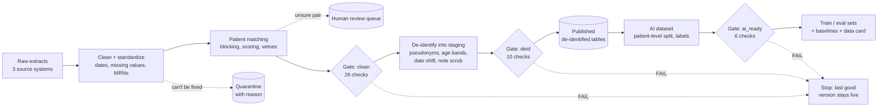

# AI-Ready Health Data Pipeline

[](https://github.com/trushna04/ai-ready-health-pipeline/actions/workflows/tests.yml)

**Messy healthcare records in, data an AI system can actually trust out.**

Hospitals want AI, but their data isn't ready. The same patient shows up three times under different record numbers. "Missing" is spelled six ways. A nurse types a phone number into a clinical note. A model trained on that produces confident garbage.

This project is the work that has to happen *before* any model: it takes deliberately messy patient data from three systems and turns it into a governed, quality-checked, de-identified dataset, with an evaluation set and a data card that says honestly what the data can and can't be used for.

> ⚠️ **Synthetic data only.** Every name, MRN, phone number and date is generated by `src/generate_messy_data.py`. No real patient data is used. This project is **not HIPAA-compliant** and makes no compliance claim. It demonstrates HIPAA-*style* governance patterns (masking, access rules, audit logging) for learning purposes.

## Results at a glance (seed 42)

| Problem | What the pipeline does | Result |
|---|---|---|
| Is this the same patient? | Rules with points and vetoes; unsure pairs go to a human | **0 wrong merges**, recall 0.91. A naive rule merges **8** pairs of twins |
| PHI hidden in free text | Scrub phones, MRNs and names from notes | **67 / 67** leaked notes scrubbed, 0 clean notes changed |
| "Allowed" isn't "safe" | Publish age bands, not birth years | One-of-a-kind patients: **296 → 37** |
| Bad data reaching users | 42 checks in 3 gates; a failure stops publishing | **9 / 9** injected faults blocked |
| AI eval you can't trust | Patient-level split, hard-case slices, baselines | Found that memorising text scores **96%**, so a high score proves little, and the [data card](docs/data_card.md) says so |

Same picture on seeds 7 and 2026.

## Run it (one command)

Requires Python 3.10+. Runs on a laptop in about 5 seconds.

```bash
python3 -m venv .venv && source .venv/bin/activate
pip install -r requirements.txt
python src/demo.py            # everything, end to end, with a summary
pytest                        # 46 unit tests
```

`demo.py` runs each step below as its own script and prints the results. Full output goes to `data/demo_log.txt`. Try `python src/demo.py --seed 7` for a different dataset.

<details>
<summary>Run the steps one at a time</summary>

```bash
python src/generate_messy_data.py   # Phase 0: messy raw data + answer key
python src/inspect_raw.py           # Phase 0: SQL profile proving the data is messy
python src/run_pipeline.py          # Phases 1-3: clean, match, gate, de-identify, gate, publish
python src/access.py                # Phase 2: role-based access demo, writes the audit log
python src/evaluate_phase1.py       # Phase 1: grade matching against the answer key
python src/evaluate_phase2.py       # Phase 2: PHI leak scan, re-identification risk, tamper test
python src/demo_gate_failures.py    # Phase 3: breaks the data 9 ways, proves each gate blocks it
python src/build_ai_dataset.py      # Phase 4: features, patient-level split, labels
python src/evaluate_phase4.py       # Phase 4: baselines that test the eval set itself
python src/data_card.py             # Phase 4: writes docs/data_card.md
```
</details>

## Architecture



Around the main flow:
- **Data dictionary**: every column is classified (direct identifier, quasi-identifier, free text, clinical, operational). A table with an undocumented column can't be published.
- **Access rules + audit log**: three roles see different tables and columns, and every read is logged in a hash-chained log that detects edits.
- **Answer key**: the generator knows the truth, so matching, scrubbing and the eval set can be *measured*. Only evaluation code reads it, never the pipeline.

## Results by phase

### Phase 1: cleaning and patient matching

Patient matching, graded on record pairs against the answer key:

| Method | Pairs merged | Wrong merges | Missed | Precision | Recall |
|---|---|---|---|---|---|
| Exact match on raw first + last + DOB | 26 | 0 | 245 | 1.000 | 0.096 |
| Last name + DOB + phone (ignores first name) | 202 | **8** | 77 | 0.960 | 0.716 |
| **This pipeline** | 246 | **0** | 25 | **1.000** | **0.908** |

- The second baseline looks reasonable but merges **twins** (same last name, DOB and phone) into one chart.
- All 25 missed pairs are in the human review queue (31 pairs, 25 truly the same person). They are missed on purpose: a record with no DOB or no first name could be a twin or a same-named relative.
- 1,304 of 1,304 clean encounters link to the correct person. All 26 true orphan encounters are quarantined, and none of the 54 encounters whose MRN lost its leading zeros were wrongly called orphans.
- Seeds 7 and 2026 give the same picture: 0 wrong merges, recall 0.94 and 0.91.

### Phase 2: governance

| Check | Result |
|---|---|
| Notes with PHI leaked into free text | 67 / 67 scrubbed, 0 with PHI left, 0 of 1,195 clean notes changed |
| Leak scan of every de-identified cell (phones, MRNs, IDs, names, ZIP5, own DOB) | **0 hits** |
| Patients unique on quasi-identifiers (k = 1) | 296 if we published birth year (Safe Harbor allows it) → **37** with age band |
| Date shifting | Lengths of stay and gaps between visits preserved exactly |
| Access demo | 3 allowed, 4 denied, all 7 in the audit log |
| Audit log tampering (edit or delete an entry) | Detected, with the entry number |

- **Safe Harbor-compliant ≠ safe.** Publishing birth year + sex + 3-digit ZIP is allowed, but it makes 57% of these patients one of a kind. So the pipeline publishes less than the rule allows.
- Every column is classified in [`docs/data_dictionary.md`](docs/data_dictionary.md). A table with an undocumented column can't be published.
- Roles: `data_steward` (full PHI, approved purpose only), `ml_engineer` (de-identified + scrubbed notes), `analyst` (de-identified, no notes).

### Phase 3: quality gates

`run_pipeline.py` runs 36 checks at two gates. **BLOCK** checks stop the run; **WARN** checks are reported, and the run continues.

```
pipeline.py ─▶ GATE clean ─▶ deidentify.py ─▶ data/staging/ ─▶ GATE deid ─▶ publish ─▶ data/deidentified/
                  │ fail                                           │ fail
                  └──────────── stop: published data unchanged ◀───┘
```

| Gate | Blocks on | Warns on |
|---|---|---|
| clean (26 checks) | missing/undocumented columns, duplicate keys, broken links between tables, raw rows not accounted for, impossible values, **two people in one golden record**, a source feed silent > 30 days, quarantine > 10% | a source feed silent > 7 days, quarantine > 6%, review queue > 6%, unusual blank rates, row counts moved > 25% vs last good run |
| deid (10 checks) | **any PHI in any cell**, direct-identifier columns, row counts ≠ clean, broken audit log, > 20% patients unique, dev key in `--strict` mode | > 5% patients unique, dev key |

**Proving the gates work:** `demo_gate_failures.py` injects 9 faults into copies of the real output (5 visits silently lost, twins merged, an orphan visit, BP 999, a 12% quarantine spike, an ER feed that went silent 60 days ago, a phone number in a scrubbed note, an undocumented `ssn` column, an edited audit log). **9 / 9 are blocked by the expected check.**

Each gate also writes a readable report, `data/quality/quality_report_<gate>.md`: what failed, why, and whether it blocks.

Today's real run publishes with 2 honest warnings: 7.1% of patients are unique on (age band, sex, ZIP3), and the dev secret key is in use. With `--strict`, the dev key blocks publishing.
- Thresholds come from the rates on seeds 7, 42 and 2026 plus headroom (e.g. encounter quarantine was 3.8–4.2%, so warn at 6%, block at 10%).

The same `--seed` always produces identical files, so results are reproducible.

### Phase 4: AI-ready outputs

Built **only from the published, gated, de-identified tables**. Two tasks:

| | Task A: note → diagnosis category | Task B: length of stay |
|---|---|---|
| Input | scrubbed free-text note | admission-time features (age, sex, insurance, visit type, source, vitals, prior visits) |
| Train / eval rows | 969 / 303 | 1,001 / 303 |
| Split | by **patient**: 354 train, 107 eval, none on both sides | same |

**What the evaluation revealed** (`evaluate_phase4.py`, baselines in plain Python):

| Note model | All | Negated notes | Empty notes |
|---|---|---|---|
| First diagnosis word wins | 85.5% | **68.8%** | 0% |
| Same, negation-aware | 96.7% | 100% | 0% |
| Memorise exact text from train | 95.7% | 98.2% | 0% |

- The **negation slice works**: "No hx of diabetes. BP elevated…" fools a first-mention rule, and handling negation fixes it.
- **The task is too easy to trust a score.** 95.7% of eval notes appear word for word in training (only 58 distinct notes), so a memoriser scores 95.7%.
- **Length of stay has no signal** beyond visit type: adding age makes inpatient error worse (2.5 → 2.8 days).
- **Hidden leakage:** 6 real people have visits on both sides, because their duplicates are still in the review queue. The patient split is only as good as the matching.
- Same picture on seeds 7 and 2026.

Everything above, plus coverage, biases and a "must NOT be trusted to" list, is in the generated [**data card**](docs/data_card.md).

## Repo layout

```
src/
  generate_messy_data.py   # Phase 0: creates the messy raw data + answer key
  inspect_raw.py           # Phase 0: DuckDB SQL profile of the raw data
  clean.py                 # Phase 1: one small function per kind of repair
  match_patients.py        # Phase 1: blocking, scoring, vetoes, clustering
  pipeline.py              # Phase 1: raw -> clean tables, quarantine, review queue
  evaluate_phase1.py       # Phase 1: grades the pipeline (the only reader of answer_key/)
  data_dictionary.py       # Phase 2: every column's meaning and sensitivity
  deidentify.py            # Phase 2: pseudonyms, generalisation, date shift, note scrubbing
  access.py                # Phase 2: role-based access + hash-chained audit log
  evaluate_phase2.py       # Phase 2: leak scan, k-anonymity, tamper test
  quality_gates.py         # Phase 3: 36 BLOCK/WARN checks, no answer key needed
  run_pipeline.py          # Phase 3: runs everything with gates; publishes only on a pass
  demo_gate_failures.py    # Phase 3: fault injection, proves each gate fires
  build_ai_dataset.py      # Phase 4: AI-ready features, split, labels, task files
  evaluate_phase4.py       # Phase 4: baselines + hidden-leakage check
  data_card.py             # Phase 4: generates docs/data_card.md
  demo.py                  # Phase 5: the whole project in one command
docs/data_dictionary.md    # generated: every column, classified
docs/data_card.md          # generated: what the AI dataset covers, its biases, what not to trust
tests/                     # 46 pytest unit tests
.github/workflows/         # runs the demo and tests on every push
data/                      # generated, not committed (see .gitignore)
  raw/                     # what the pipeline is allowed to read
  answer_key/              # ground truth for GRADING only; the pipeline never reads it
  clean/                   # patient_records, golden_patients, encounters
  quarantine/              # rows held back, raw values kept, with a reason
  review/                  # possible matches for a human to decide
  deidentified/            # masked tables for analysts and ML
  audit/                   # access log (JSON lines, hash-chained)
  staging/                 # de-identified tables waiting for the deid gate
  quality/                 # gate reports, run history, last good run's counts
  ai_ready/                # features, train/eval files per task, eval results
  demo_log.txt             # full output of the last demo run
BUILD_LOG.md               # decisions and progress, phase by phase
```

## The answer key (why it exists)

Because we generate the data, we know the truth: which records are really the same person, and what each visit was really about. That lets us **measure** the pipeline (matching precision/recall, label accuracy) instead of just claiming it works. The pipeline itself must never read `data/answer_key/`. Only evaluation code does.

## Local → GCP mapping

Everything runs on a laptop. At company scale, each piece maps to a managed GCP service:

| Local (this repo) | GCP equivalent | Notes |
|---|---|---|
| `data/raw/` folder | Cloud Storage bucket | Landing zone for raw extracts |
| DuckDB | BigQuery | Same SQL ideas; serverless and scales to billions of rows |
| Python scripts | Dataflow (or Cloud Run jobs for small batch) | Dataflow when data outgrows one machine |
| Running scripts in order / scheduled runs | Cloud Composer (managed Airflow) | DAG with retries, alerts, backfills |
| `match_patients.py` | Custom matching in BigQuery SQL / Dataflow, or a managed MPI (master patient index) | Blocking is what makes this possible at scale |
| `data/quarantine/` tables | Quarantine dataset in BigQuery | Same idea: bad rows kept with a reason, never silently dropped |
| `data/review/` queue | A review table + simple app (e.g. AppSheet or Looker) for data stewards | Humans decide uncertain matches |
| `scrub_note()` regex + name list | Sensitive Data Protection (Cloud DLP) | Managed detectors for 150+ PHI types, de-identify transforms incl. date shift |
| `PIPELINE_SECRET_KEY` env var | Secret Manager / Cloud KMS | The pseudonym key never lives in code |
| `data_dictionary.py` | Dataplex / Data Catalog + policy tags | Sensitivity labels attached to columns |
| `access.py` policy | BigQuery column-level security (policy tags) + authorized views | Enforced by the database, not by Python |
| `data/audit/access_log.jsonl` | Cloud Audit Logs (Data Access logs) → locked log bucket | Immutable, outside the data team's control |
| `quality_gates.py` | Dataplex data quality scans / dbt tests / Great Expectations | Same BLOCK/WARN idea as declarative rules |
| `run_pipeline.py` (stop on FAIL) | Cloud Composer DAG with a gate task; failure halts downstream tasks and alerts | Retries, alerts, run history built in |
| staging → publish swap | Write to a staging dataset, then swap the table/view used by readers | Readers never see half-checked data |
| `data/ai_ready/` + patient-hash split | BigQuery feature tables → Vertex AI datasets (or Vertex AI Feature Store) | Split column stored with the data, so every model uses the same split |
| `evaluate_phase4.py` baselines + slices | Vertex AI Model Evaluation, with eval slices | Track scores per hard-case slice, not just overall |
| `docs/data_card.md` | Model/data cards in Vertex AI Model Registry or Dataplex | The limits travel with the dataset |

## What this project does NOT prove

- The mess is designed by the generator, so the pipeline is partly tested against problems we already know about. Real data has surprises.
- Small scale (hundreds of patients, not millions).
- No HL7/FHIR feeds, claims data, or real clinical coding (ICD-10).
- The note scrubber is tested on the three PHI patterns the generator leaks. Real notes leak addresses, dates, ages and names in many more ways; production would use a managed detector (Cloud DLP) plus human spot checks.
- Access rules are enforced in Python. Anyone with file access can read the CSVs directly. Real enforcement belongs in the database (BigQuery policy tags).

## What I'd do differently at real scale

| Here | At a real hospital or HIE |
|---|---|
| Hand-written matching rules | Probabilistic matching (Fellegi-Sunter / Splink-style weights) tuned on steward decisions, plus the rules as vetoes |
| A review queue in a CSV | A steward tool with SLAs, and the queue **resolved before** building AI splits (here, 6 people leaked across train/eval because of it) |
| Regex note scrubber | Cloud DLP or a clinical de-identification model, measured on a hand-labeled sample, with human spot checks |
| Access rules in Python | Enforced in the warehouse: BigQuery policy tags and authorized views |
| Thresholds from 3 seeds | Thresholds from weeks of real history, tuned as false alarms come in, with an owner per check |
| Perfect synthetic labels | ICD-10 codes or coder review, with measured agreement between coders |
| Eval notes copied from training | An eval set of notes never seen in training, written by different clinicians |
| One laptop, batch | Composer DAG on BigQuery + Dataflow; incremental loads; freshness measured in hours |

## Interview story (2 minutes)

> **The problem.** Every healthcare company wants AI, but their data isn't ready. The hardest part isn't the model, it's the data underneath: the same patient appears as three records with different MRNs, names are nicknamed or misspelled, and PHI gets typed into free-text notes. A model trained on that produces confident garbage, and in healthcare that's a patient-safety problem.
>
> **What I built.** A pipeline that takes deliberately messy synthetic data from three systems, two clinics and an ER, and makes it AI-ready. I generated the data myself, with an answer key, so every step is *measured*, not claimed.
>
> First, patient matching. The obvious rule, last name plus date of birth plus phone, merges twins into one chart: 8 wrong merges. My rules use vetoes, so different first names or birth dates can never merge, and anything uncertain goes to a human. Zero wrong merges, 91% recall, and every pair I missed is sitting in the review queue.
>
> Second, governance. I scrubbed PHI out of the notes, 67 out of 67, and I found that HIPAA Safe Harbor *allows* publishing birth year, but that leaves 296 of 519 patients one of a kind. Age bands bring it to 37. Compliant isn't the same as safe.
>
> Third, quality gates: 42 checks that stop the pipeline before bad data is published. I proved they work by breaking the data nine different ways. All nine were blocked.
>
> Finally, the AI dataset: split by patient, with a data card. And the most useful finding was negative: a model that just memorizes note text scores 96% on the eval set, so the eval can't tell a real model from a lookup table. The data card says that plainly.
>
> **At real scale** I'd use probabilistic matching tuned on steward decisions, resolve the review queue before splitting, use Cloud DLP instead of regex, and enforce access in BigQuery. The local pieces map one to one to BigQuery, Dataflow and Composer.

## Why I built it this way

- **Everything is measured.** The answer key exists so I can say "0 wrong merges", not "the matching is good".
- **Every decision has a tradeoff written down.** See [`BUILD_LOG.md`](BUILD_LOG.md), phase by phase.
- **Plain code over clever code.** Every rule is a readable Python function I can explain; the GCP table above shows the managed tools I'd use at scale.

## License

[MIT](LICENSE). Synthetic data and code only; nothing here is medical advice.
